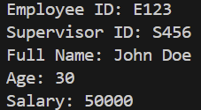

# Vererbung

Erstelle ein Basisklasse Person, von welcher die Klasse Employee abgeleitet werden soll.


Die Klasseneigenschaften und Methoden entnimm dem
Klassendiagramm.

Es sollen sämtliche Methoden ausprogrammiert werden.
Erweitere die Mitarbeiter (Employee) Klasse um die Eigen-
schaften: - SupervisorID, - Salary
und die Methoden: set/get für beides und eine Methode
salaryIncrease(float). 


---

## 📋 Projektinformationen

| Feld              | Inhalt                          |
|-------------------|---------------------------------|
| **Projektname**   | Vererbung                   |
| **Klasse**        | 2aAPC                  |
| **Schuljahr**     | 2026/27                |
| **Abgabedatum**   | 20.11.2026                   |
| **Autor/in**      | Auer Alexander             |
| **Lehrer/in**     | Gerhard Jarz            |
| **Fach**          | ITL1/ITL2 |
---

## 📝 Projektbeschreibung

Beschreibe hier ausführlich:
- **Ziel der Applikation:** Was soll die App leisten?
Des ist eine einfache Java-Anwendung, die die Konzepte der Vererbung demonstriert. Sie enthält eine Basisklasse `Person` und eine abgeleitete Klasse `Employee`, die zusätzliche Eigenschaften wie `employeeId`, `supervisorId` und `salary` hat. Die Anwendung erstellt ein `Employee`-Objekt, setzt dessen Eigenschaften und gibt alle Informationen auf der Konsole aus.

- **Hauptfunktionen:** Was kann die App?
Die App kann:
  - Ein `Employee`-Objekt erstellen
  - Die Eigenschaften des `Employee`-Objekts setzen (z. B. `supervisorId`, `salary`)
  - Alle Informationen des `Employee`-Objekts auf der Konsole ausgeben

---

## 📸 Screenshot

> Füge hier einen Screenshot der laufenden Applikation ein.



<!-- So fügst du einen Screenshot ein:
     1. Screenshot erstellen und als "screenshot.png" im Projektordner speichern
     2. Den Pfad oben anpassen, falls der Screenshot woanders liegt
     Alternativ: mehrere Screenshots für verschiedene Ansichten -->

---

## 🛠️ Entwicklungsumgebung

### Verwendete Software & Tools

| Tool / Software      | Version     | Zweck                          |
|----------------------|-------------|--------------------------------|
| VS Code             | —           | Code-Editor                    |
| JDK                 | ab 25       | Kompilieren und Ausführen      |
| Git                 | —           | Versionskontrolle              |


### Betriebssystem (Entwicklung)

- **OS:** Ubuntu 24.04 LTS

---

## 🚀 Installation & Ausführung

### Voraussetzungen

- JDK 25 oder neuer installiert
- Git zum Klonen des Repositorys

### Schritte

```bash
# Im Projektordner kompilieren
javac -d out src/Domain/Models/Person.java src/Domain/Models/Employee.java src/Main.java

# Programm starten
java -cp out Main
```

> **Hinweis:** Keine externen Bibliotheken erforderlich.

---

## 🔗 Quellen

### Links & Dokumentation

| Quelle | URL / Beschreibung |
|--------|--------------------|
| Offizielle Java-Dokumentation | https://docs.oracle.com/en/java/ |

### KI-Unterstützung

| Tool | Verwendeter Prompt / Zweck |
|------|----------------------------|
| OpenCode | Unterstützung bei der README |

---

## ⚠️ Bekannte Probleme / Limitierungen

- Keine dauerhafte Speicherung der Daten.
- Nur feste Beispieldaten, keine interaktive Eingabe.

---

## 📄 Lizenz

Dieses Projekt wurde im Rahmen des Schulunterrichts erstellt und ist nicht für die kommerzielle Nutzung vorgesehen.
