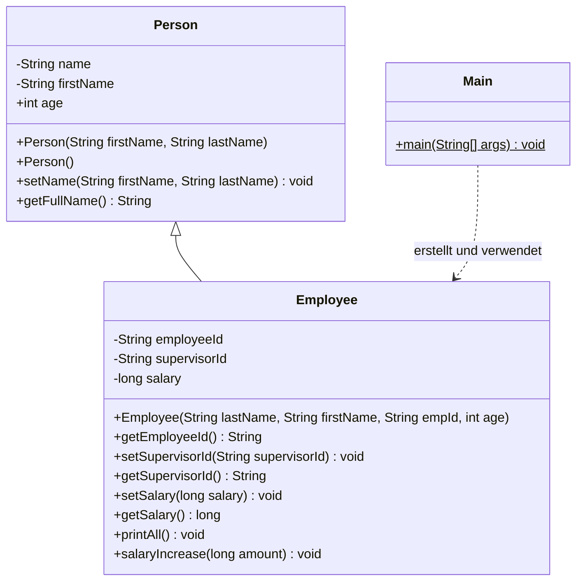

# Lab 01: Vererbung

| | |
|---|---|
| Name | Auer Alexander |
| Klasse | 2aAPC |
| Datum | 25.11.2026 |

## 1. Ziel

Als Wiederholung der 1. Klasse soll ich die Konzepte der Vererbung in Java anwenden. Ich soll eine Klasse `Person` erstellen, die die Eigenschaften `firstName`, `lastName` und `age` hat. Außerdem soll ich eine Unterklasse `Employee` erstellen, die zusätzlich die Eigenschaften `salary` und `position` hat. Ich soll Methoden implementieren, um den vollen Namen der Person zurückzugeben und das Gehalt des Mitarbeiters zu erhöhen.

## 2. Planung

Ich bin nirgendst von den Vorgaben abgewichen. Ich habe die Klassen `Person` und `Employee` wie gefordert implementiert. Die Methoden `getFullName()` und `salaryIncrease(long amount)` sind ebenfalls enthalten.

## 3. Umsetzung

Beschreibe die wichtigsten Entscheidungen in Stichworten. Zeige nur kurze Codeausschnitte, die du erklärst, nicht den gesamten Quelltext.

## 4. Tests

| Test | Erwartung | Ergebnis |
|---|---|---|
| `fullName()` | | |
| `salaryIncrease(10)` | | |
| negatives Alter | | |
| `Person p = new Employee(...)` | | |

## 5. Reflexion

1. Warum sind die Eigenschaften `private`?
2. Wann ist `protected` sinnvoll?
3. Was passiert ohne `super(...)`?

## 6. Probleme und Lösungen

| Problem | Lösung |
|---|---|
| | |

## 7. Quellen und Hilfsmittel

Nenne Webseiten, Mitschüler und KI-Werkzeuge, die du genutzt hast, und wofür.
