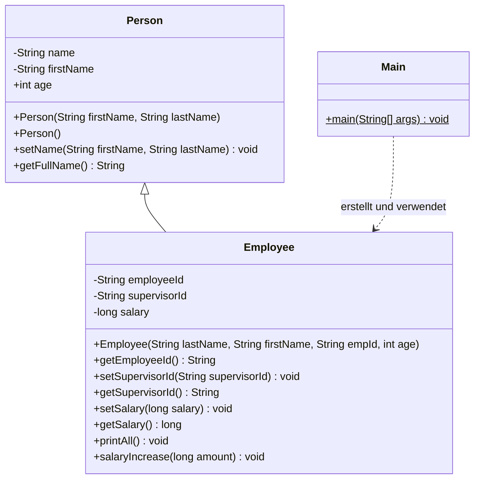
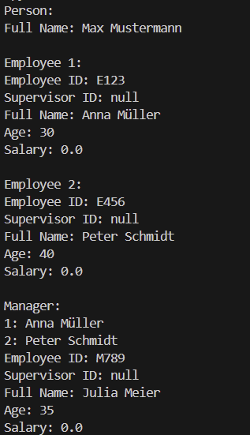

# Lab 01: Vererbung

| | |
|---|---|
| Name | Auer Alexander |
| Klasse | 2aAPC |
| Datum | 25.11.2026 |

## 1. Ziel

Als Wiederholung der 1. Klasse soll ich die Konzepte der Vererbung in Java anwenden. Ich soll eine Klasse `Person` erstellen, die die Eigenschaften `firstName`, `lastName` und `age` hat. Außerdem soll ich eine Unterklasse `Employee` erstellen, die zusätzlich die Eigenschaften `salary` und `position` hat. Ich soll Methoden implementieren, um den vollen Namen der Person zurückzugeben und das Gehalt des Mitarbeiters zu erhöhen.

## 2. Planung

Ich bin nirgendst von den Vorgaben abgewichen. Ich habe die Klassen `Person` und `Employee` wie gefordert implementiert. Die Methoden `getFullName()` und `salaryIncrease(long amount)` sind ebenfalls enthalten.

## 3. Umsetzung

Angefangen habe ich mit der Klasse `Person`. Ich habe sämtliche Attribute eingebaut (wie im UML Diagramm vorgegeben). Die Employee Klasse habe ich dann von der Person Klasse abgeleitet. Ich habe die Konstruktoren und Methoden implementiert, die im UML Diagramm angegeben sind. Die Methode `salaryIncrease(double percentAmount)` erhöht das Gehalt des Mitarbeiters um die angegebenen Prozent.

Zusätzlich habe ich die freiwillige Zusatzaufgabe Manager abgeschlossen. Ein Manager kann mehrere Mitarbeiter verwalten. Ich habe die Klasse `Manager` erstellt, die eine Liste von `Employee` Objekten enthält. Die Methoden `addEmployee(Employee employee)` und `removeEmployee(Employee employee)` ermöglichen das Hinzufügen und Entfernen von Mitarbeitern. Die Methode `printAllEmployees()` gibt alle Mitarbeiter des Managers aus.

## 4. Tests

| Test | Erwartung | Ergebnis |
|---|---|---|
| `fullName()` | Max Mustermann | Max Mustermann |
| `salaryIncrease(10)` | 11 | 11 |
| Negatives Alter (`setAge(-10)`) | Wirft `IllegalArgumentException` | Wirft `IllegalArgumentException` |
| `Person p = new Employee(...)` | Die Zuweisung funktioniert und `p.getFullName()` liefert „Max Mustermann“ | Die Zuweisung funktioniert und `p.getFullName()` liefert „Max Mustermann“ |

## 5. Reflexion

1. Warum sind die Eigenschaften `private`?
Man nennt das Encapsulation. Es schützt die Eigenschaften vor unkontrolliertem Zugriff von außen. Stattdessen werden Getter- und Setter-Methoden verwendet, um den Zugriff zu kontrollieren und Validierungen durchzuführen.
2. Wann ist `protected` sinnvoll?
Protected erlaubt Child Classes den Zugriff von Attributen der Parent Klasse. Es ist sinnvoll, wenn man möchte, dass Unterklassen auf bestimmte Eigenschaften oder Methoden der Oberklasse zugreifen können, während sie für andere Klassen verborgen bleiben.
3. Was passiert ohne `super(...)`?
Attribute die im Konstruktor der Parent Class gesetzt werden bleiben leer (null). Die Parent Class wird nicht initialisiert und es kann zu unerwartetem Verhalten kommen.

## 6. Probleme und Lösungen

Keine Probleme.

## 7. Quellen und Hilfsmittel

Programmierung: Vorerfahrung aus der 1. Klasse und C# + Java Tutorials auf YouTube
Readme und Dokumentation: Selbst geschrieben und mit ChatGPT überprüft und verfeinern lassen
